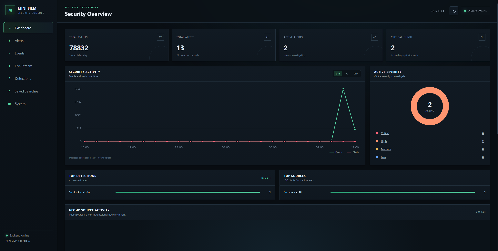
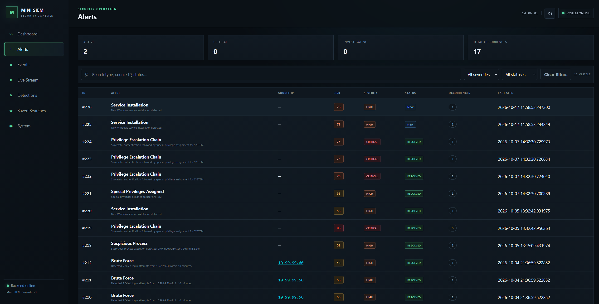
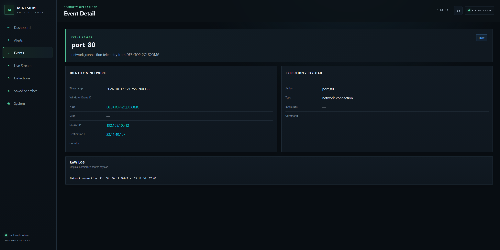
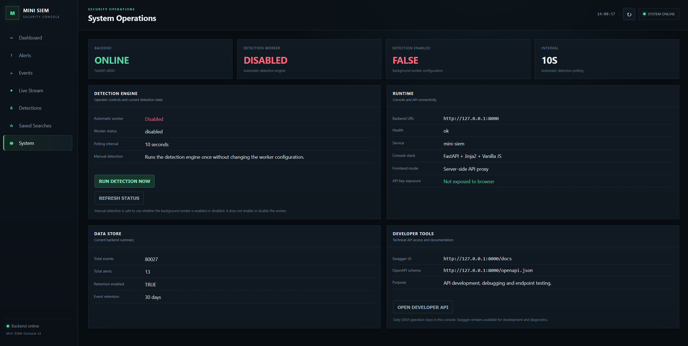

# Mini SIEM — AI-Assisted Automation Project

> **Portfolio / case study:** projekt pokazujący, jak wykorzystuję AI do szybkiej nauki, pracy z danymi, automatyzacji i dowożenia działających rozwiązań od pomysłu do gotowego efektu.

Mini SIEM to mój projekt własny: system, który automatycznie zbiera dane z logów Windows, porządkuje je, analizuje i pokazuje najważniejsze informacje w czytelnym panelu.

Projekt rozwijałem intensywnie z pomocą narzędzi LLM, traktując AI nie jako „generator odpowiedzi”, ale jako **asystenta, nauczyciela i partnera do rozwiązywania problemów**.

> Kod źródłowy nie jest publikowany w całości. To repozytorium jest celowo przygotowane jako **case study procesu, efektu i sposobu pracy z AI**.

---

## Co zbudowałem?

Zbudowałem działający system od A do Z:

**dane → uporządkowanie → analiza → automatyzacja → czytelny wynik**

System potrafi m.in.:

- automatycznie zbierać dane z logów Windows,
- porządkować tysiące zdarzeń do jednej, spójnej formy,
- wykrywać wybrane nietypowe sytuacje,
- tworzyć alerty i nadawać im priorytet,
- filtrować i przeszukiwać informacje,
- analizować użytkowników, komputery i adresy IP,
- pokazywać historię konkretnego zdarzenia,
- prezentować wyniki w przejrzystym dashboardzie.

Najważniejsze było dla mnie nie samo „zrobienie aplikacji”, ale stworzenie procesu, w którym jak najwięcej powtarzalnej pracy wykonuje się automatycznie.

---

## Dlaczego zrobiłem ten projekt?

Chciałem sprawdzić, jak daleko można dojść, wykorzystując AI jako codzienne narzędzie do pracy.

Założyłem sobie ambitny cel: zbudować kompletny, działający system, mimo że część potrzebnych narzędzi i zagadnień poznawałem dopiero w trakcie projektu.

Dzięki temu ćwiczyłem jednocześnie:

- pracę z dużą liczbą danych,
- automatyzację powtarzalnych czynności,
- analityczne rozwiązywanie problemów,
- szybkie uczenie się,
- prompt engineering,
- weryfikowanie rezultatów generowanych przy wsparciu AI.

---

## Jak wykorzystywałem AI?

Mój typowy sposób pracy wyglądał tak:

**problem → kontekst → precyzyjny prompt → propozycja rozwiązania → test → analiza → poprawa**

AI pomagało mi:

- szybko wejść w nowe tematy,
- rozbijać duże problemy na mniejsze kroki,
- przygotowywać pierwsze wersje rozwiązań,
- automatyzować powtarzalne zadania,
- analizować błędy i dane,
- porównywać różne podejścia,
- poprawiać rozwiązania na podstawie wyników testów.

Najważniejsza zasada: **nie przyjmowałem odpowiedzi AI bez sprawdzenia**. Każdą większą zmianę testowałem na działającym systemie i realnych danych.

Więcej: **[AI_WORKFLOW.md](AI_WORKFLOW.md)**

---

## Przykład: AI jako partner w analizie problemu

Podczas testowania system zaczął generować alarmy, które początkowo wyglądały jak poważne zdarzenia bezpieczeństwa.

Zamiast analizować wszystko ręcznie:

1. zebrałem rzeczywiste dane źródłowe,
2. przekazałem AI kontekst i przykładowe logi,
3. porównałem powtarzające się wzorce,
4. znalazłem źródło błędnej klasyfikacji,
5. poprawiłem sposób przetwarzania danych,
6. ponownie przetestowałem rezultat.

Efekt: mniej fałszywych alarmów i bardziej użyteczne dane.

To dobrze pokazuje moje podejście do AI:  
**nie pytam tylko „co zrobić?”, ale wykorzystuję AI do szybszego przejścia od problemu do zweryfikowanego rozwiązania.**

---

## Jak przekładam to na pracę z danymi i automatyzacją?

Domena projektu to cyberbezpieczeństwo, ale sposób pracy jest uniwersalny.

Ten sam model można zastosować do danych biznesowych:

**zbieranie → czyszczenie → porządkowanie → weryfikacja → analiza → wynik**

Przykładowo przy pracy z danymi o lokalizacjach sklepów podobne podejście można wykorzystać do:

- łączenia informacji z kilku źródeł,
- automatycznego porządkowania danych,
- wykrywania braków i niespójności,
- przygotowywania prostych skryptów eliminujących ręczną pracę,
- wykorzystywania LLM do klasyfikacji i analizy informacji,
- szybkiego przygotowywania danych do dalszych decyzji.

To właśnie obszar **AI + dane + automatyzacja** chcę rozwijać dalej.

---

## System w praktyce

Poniższe miejsca są przygotowane na kilka najlepszych screenshotów działającego systemu.

### Dashboard

### Alerty i priorytety

### Szczegóły zdarzenia

### Panel systemowy

---

## Czego nauczył mnie ten projekt?

Największa wartość projektu nie wynika z jednej konkretnej technologii.

Projekt nauczył mnie:

- precyzyjnie przekazywać AI kontekst, cel i ograniczenia,
- szybko uczyć się nowych narzędzi,
- dzielić duży problem na mniejsze zadania,
- automatyzować powtarzalne czynności,
- weryfikować odpowiedzi AI na realnych danych,
- poprawiać proces na podstawie wyników,
- przechodzić od pomysłu do działającego rozwiązania.

---

## Wykorzystane narzędzia

**Technologie:** Python • PostgreSQL • FastAPI • Docker • PowerShell • HTML/CSS/JavaScript  
**Wsparcie AI:** ChatGPT • Claude

Technologie były dla mnie środkiem do celu. Najważniejsze było stworzenie działającego procesu, który automatycznie zbiera, porządkuje i analizuje dane.

---

## Zobacz też

- **[AI_WORKFLOW.md](AI_WORKFLOW.md)** — jak pracowałem z AI i jak budowałem prompty
- **[PROJECT_OVERVIEW.md](PROJECT_OVERVIEW.md)** — krótki opis projektu i jego działania

---

## Status

Projekt jest rozwijany jako praktyczne środowisko do nauki pracy z danymi, automatyzacją i AI-assisted development.
